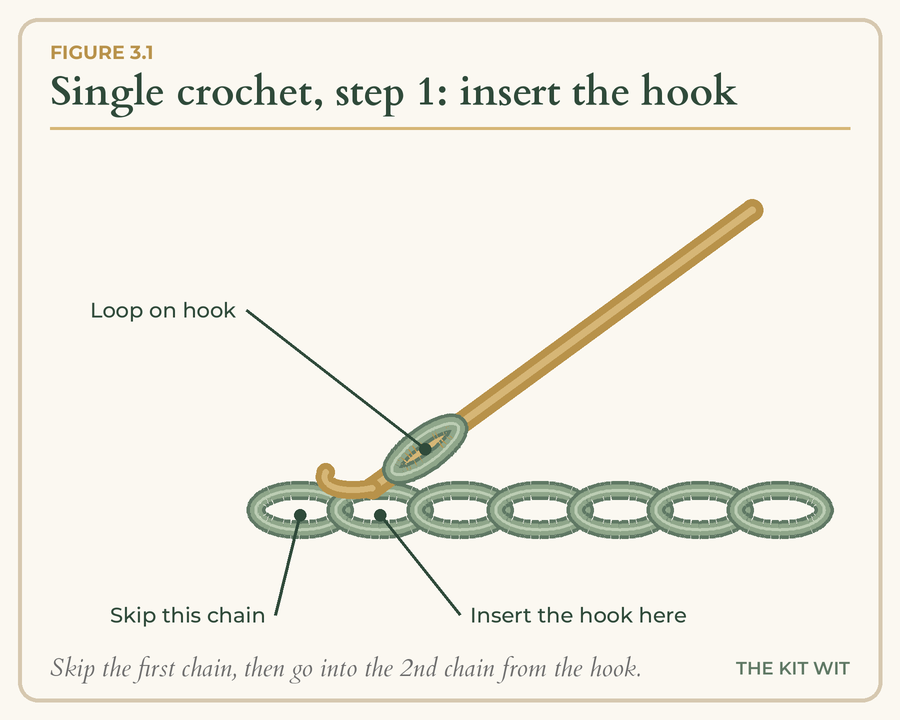
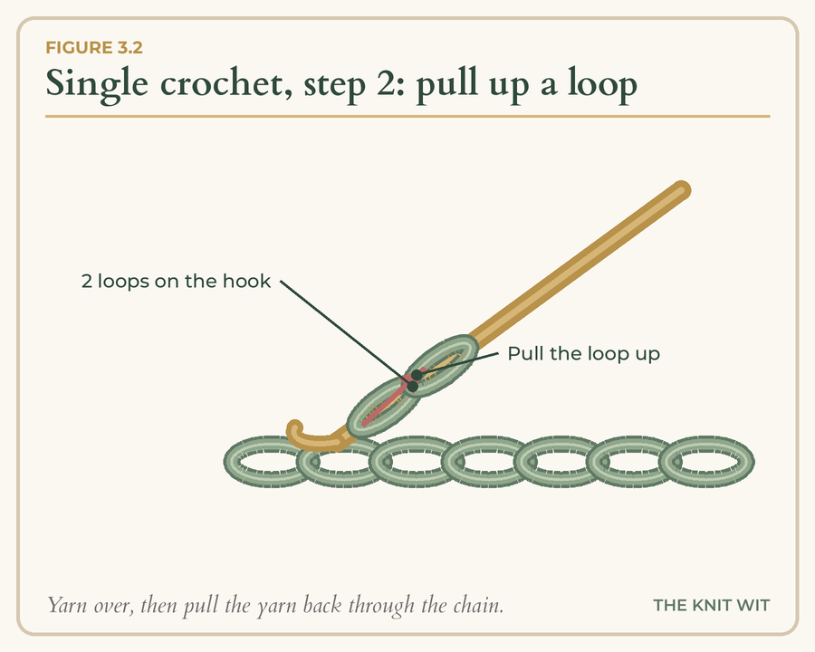
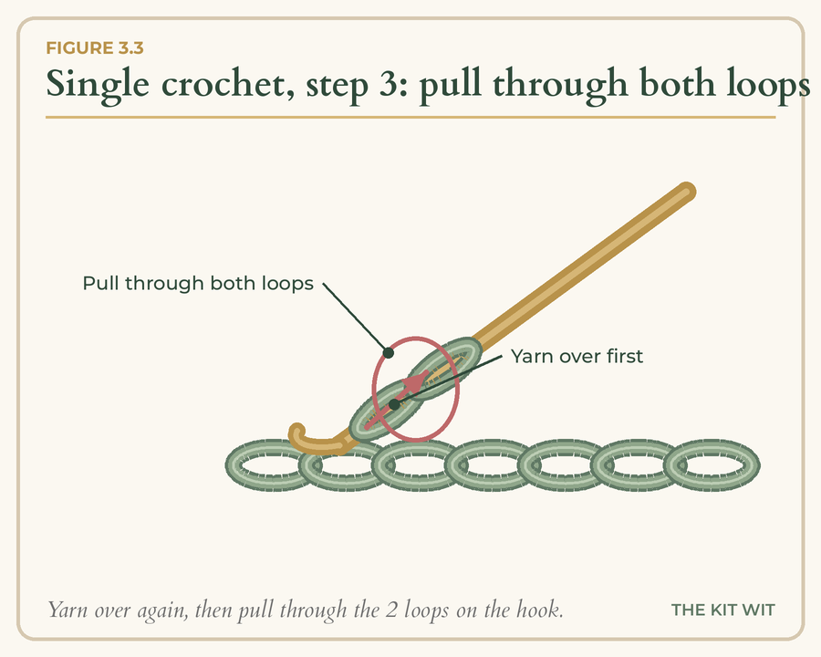
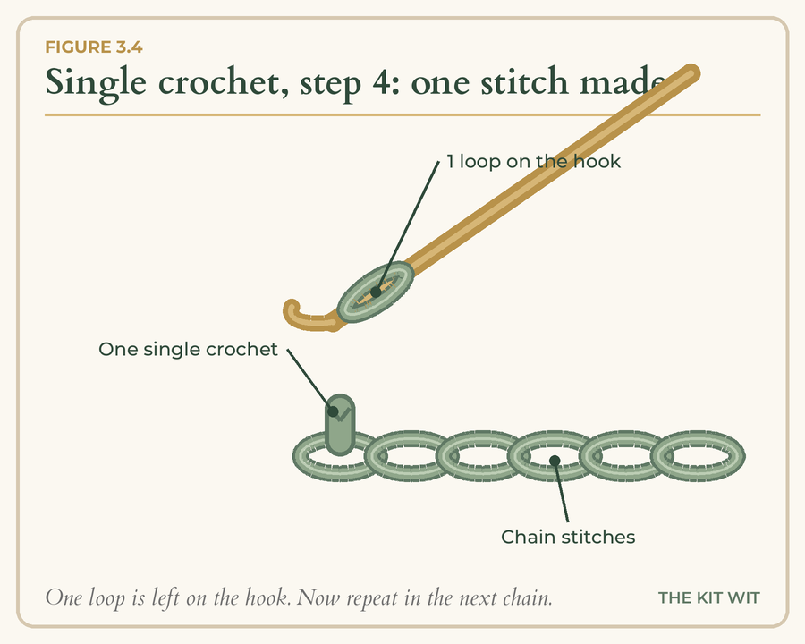

Single crochet is the most common crochet stitch. It makes a tight, sturdy fabric, and you can use it for scarves, coasters, bags, and toys.

## What you need
- Yarn
- A crochet hook (5mm or 6mm)
- A row of 15 chain stitches (see our chain stitch lesson)

## Steps

**1. Insert the hook.** Skip the first chain next to your hook. Put your hook into the **second chain** from the hook.

**2. Pull up a loop.** Yarn over, then pull the yarn back through the chain. You now have **2 loops** on your hook.

**3. Pull through both loops.** Yarn over again and pull through **both loops** on your hook.

**4. One stitch made.** You have 1 loop left. That's one single crochet! Put your hook into the next chain and repeat until the end of the row.

## Tips
- Count your stitches at the end of each row so your edges stay straight.
- If your stitches feel too tight, try a bigger hook.
- Go slowly. Speed comes with practice.

## What's next?
Now you can turn your work and make a second row. That's our next lesson!
