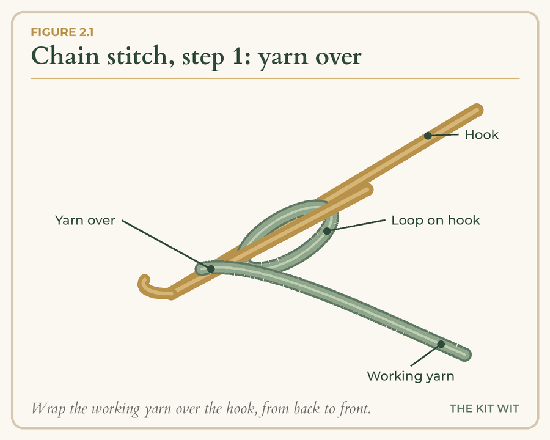
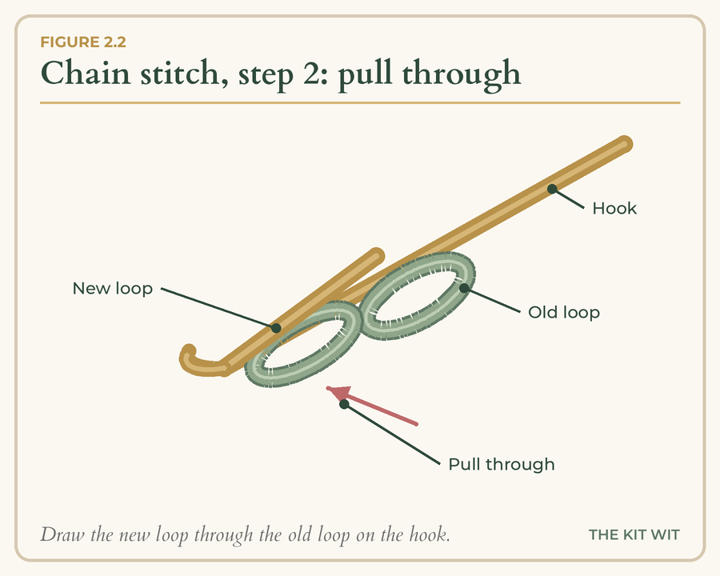
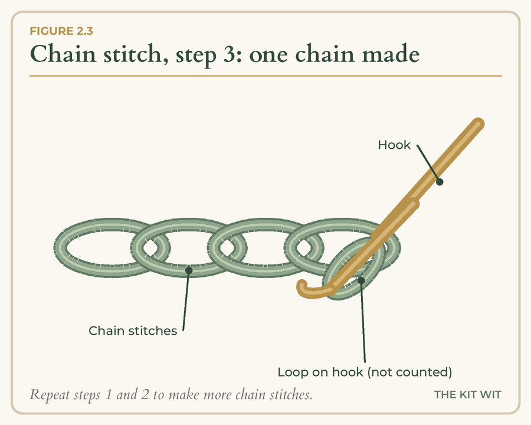

The chain stitch is the base of almost every crochet project. Once you can chain, you can start making scarves, blankets, and more.

## What you need
- Yarn
- A crochet hook (5mm or 6mm)
- A slip knot on your hook (see our slip knot lesson)

## Steps

**1. Yarn over.** Hold the hook in your right hand like a pencil. Wrap the working yarn over the hook, from back to front.

**2. Pull through.** Draw the yarn through the loop that is already on your hook.

**3. One chain made.** You now have one new loop on the hook. That's one chain! Repeat steps 1 and 2 to make more.

## Tips
- Keep your stitches loose, not tight. It's easier to put your hook in loose chains later.
- Don't count the loop on your hook as a chain.
- Practice making 20 chains in a row. Your chains will get more even each time.

## What's next?
Now that you can chain, you are ready to learn the single crochet stitch. That's our next lesson!
