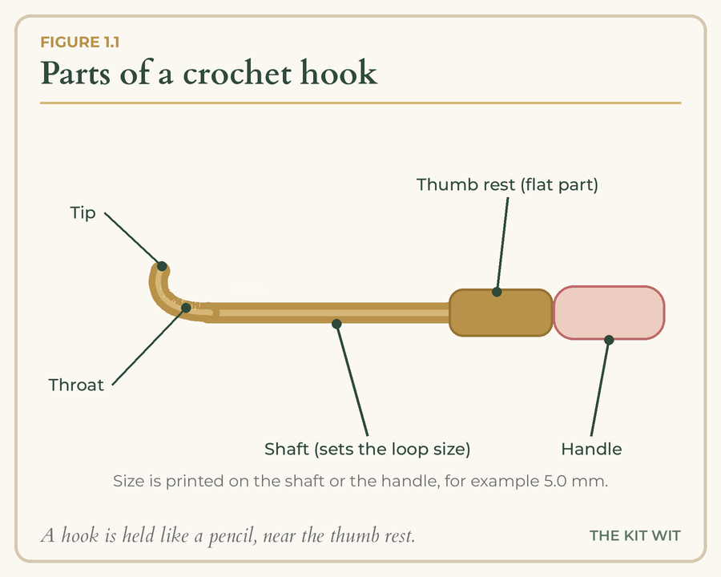
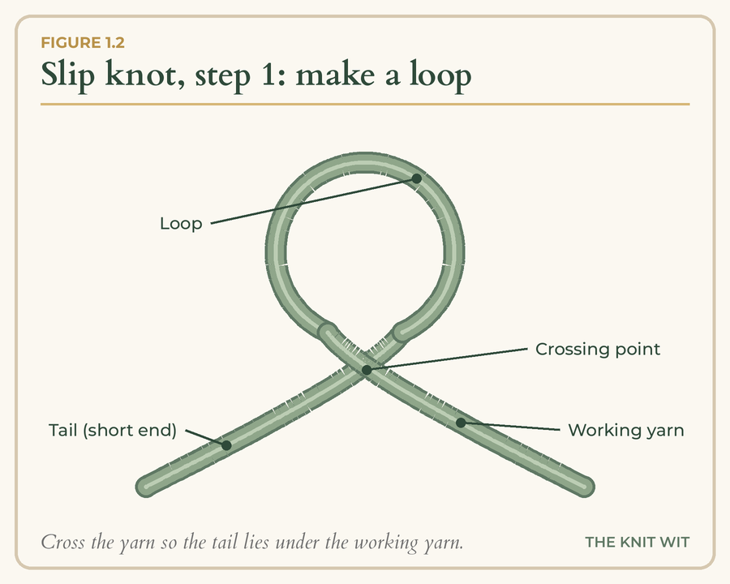
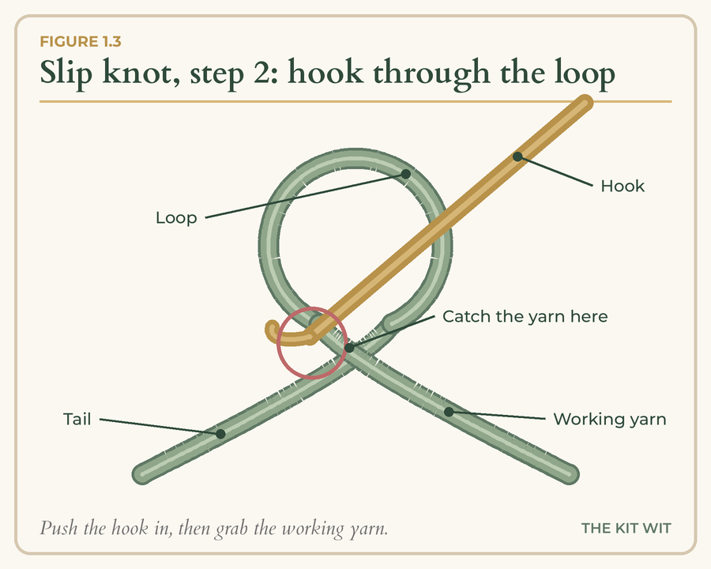
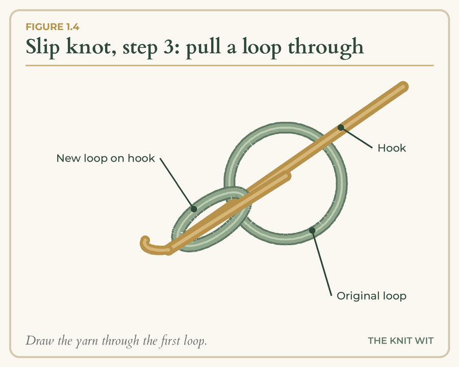
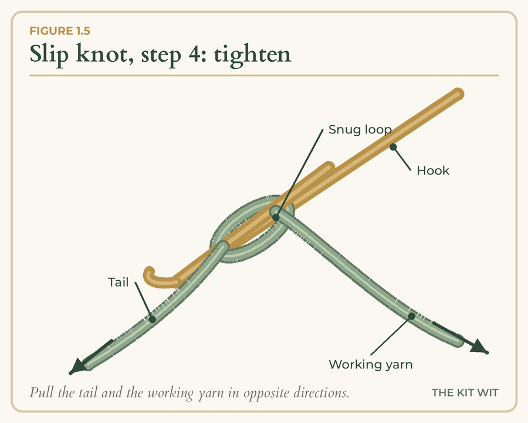

Every crochet project starts with a slip knot. It's the first loop on your hook, and it's easy once you try it a few times.

## What you need
- A ball of yarn (thick, light-colored yarn is easiest to see)
- A crochet hook (size 5mm or 6mm is good for beginners)

## Steps

**1. Make a loop.** Pull out about 6 inches of yarn from the ball. This is your tail. Cross the tail under the yarn coming from the ball to make a loop.

**2. Hook through the loop.** Pinch the crossing point. Push your hook through the loop and catch the working yarn.

**3. Pull a loop through.** Draw the yarn back through the loop. You will see a new loop on your hook.

**4. Tighten.** Gently pull the tail and the working yarn in opposite directions. The loop should be snug on the hook but still slide a little.

## Common mistakes
- **Too tight:** If the loop won't move, make it a little looser.
- **Too loose:** If it falls off the hook, pull the tail a bit more.

## What's next?
Once you have your slip knot, you are ready to learn the chain stitch. That's the next lesson!
