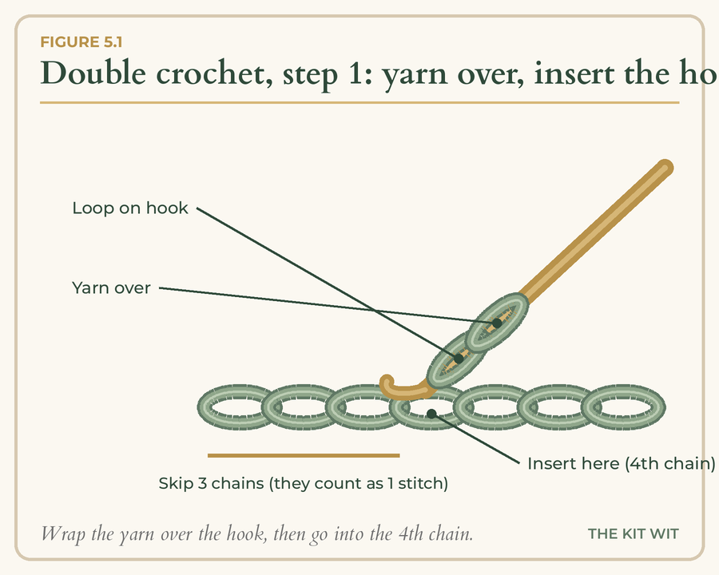
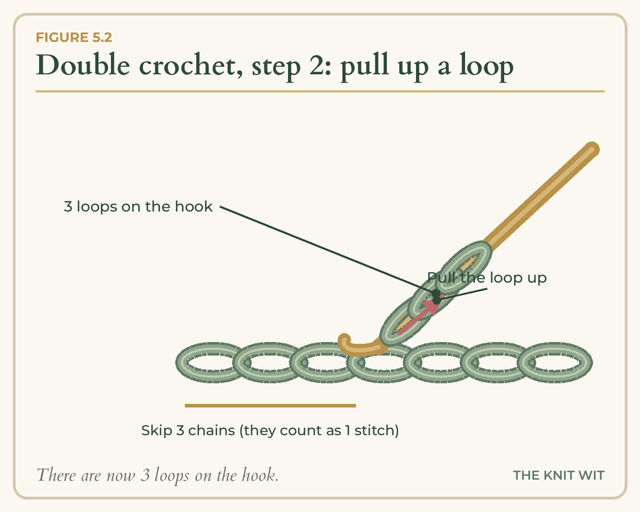
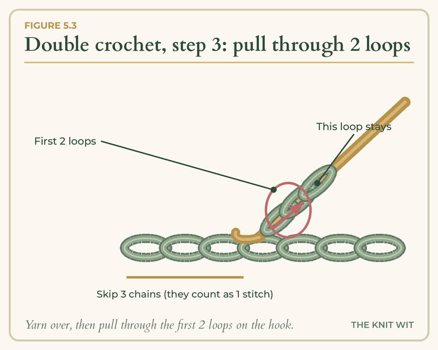
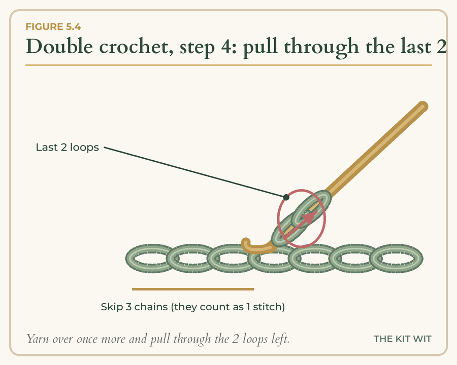
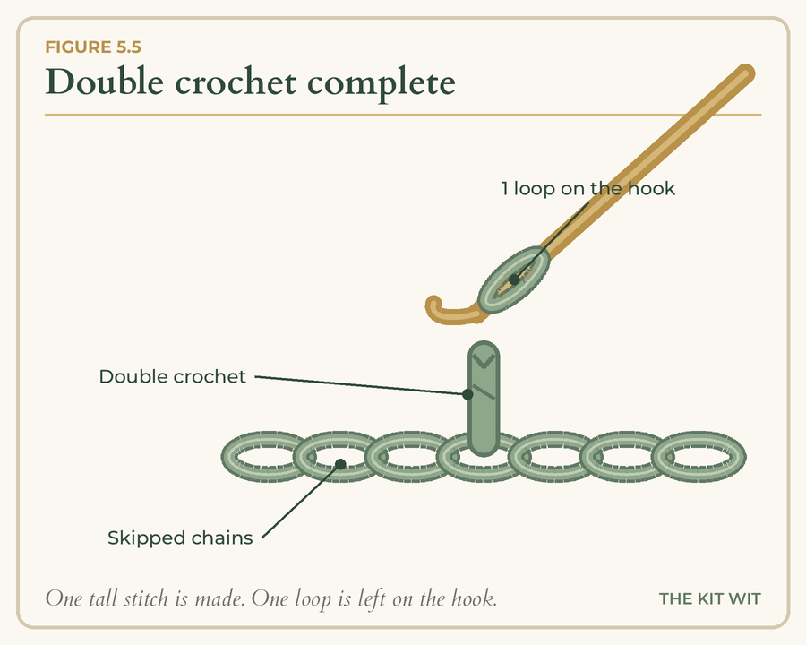

The double crochet is taller than the single crochet, so you cover more space with fewer stitches. It's used in blankets, shawls, and lots of popular patterns.

## What you need
- Yarn
- A crochet hook (5mm or 6mm)
- A chain of 17 stitches (see our chain stitch lesson)

## Steps

**1. Yarn over and insert the hook.** Wrap the yarn over the hook, then put the hook into the **4th chain from the hook**.

**2. Pull up a loop.** Yarn over and pull the yarn back through the chain. You now have **3 loops** on your hook.

**3. Pull through 2 loops.** Yarn over and pull through the **first 2 loops**. You now have 2 loops left.

**4. Pull through the last 2.** Yarn over again and pull through the **last 2 loops**. You now have 1 loop left.

**5. One tall stitch made.** That's one double crochet! For the next stitch, yarn over first, then go into the next chain and repeat to the end of the row.

## Tips
- Remember the order: yarn over first, then three "pull through" moves.
- The first 3 chains at the start of a row count as your first stitch.
- Take it slowly. This one takes a few tries.

## What's next?
You now know the three most important stitches. Next, we will learn how to read a real crochet pattern!
