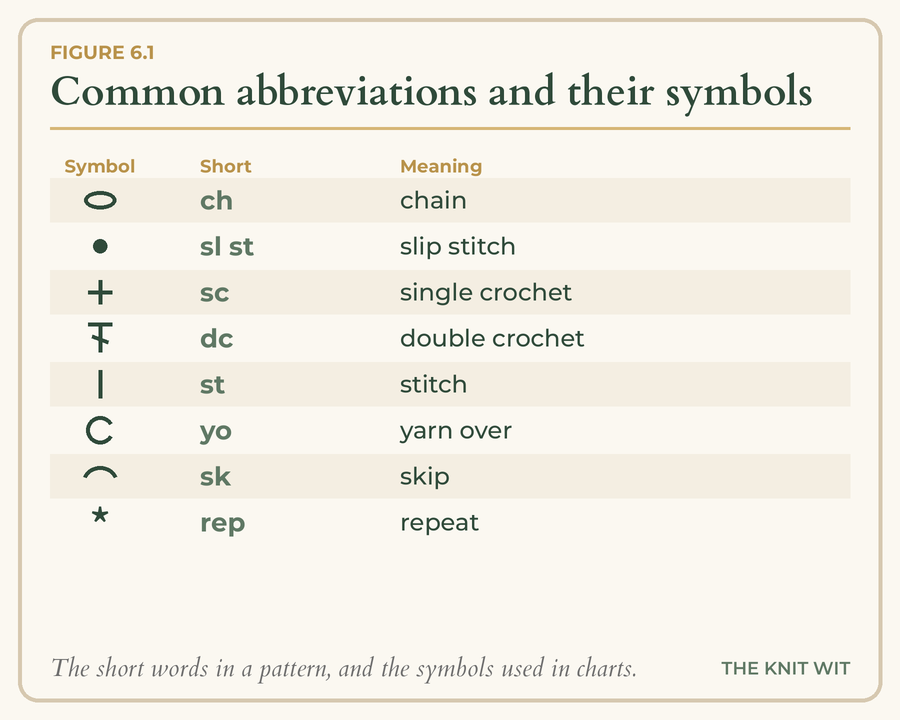
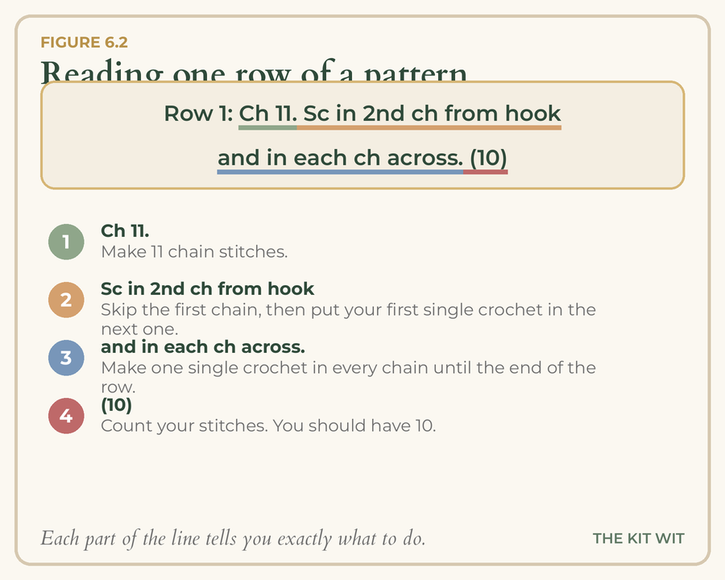
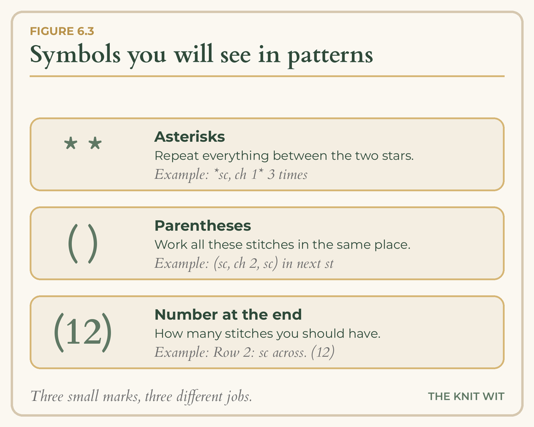

Crochet patterns look like a secret code at first. Once you know the short words, they're easy to follow.

## Common abbreviations

## Reading one row

Here is a real example. Each part of the line tells you exactly what to do.

## Symbols you will see

## US and UK names
Patterns use different names depending on the country. A **US double crochet** is called a **treble** in UK patterns. Always check which one your pattern uses. It's usually written at the top.

## Tips
- Read the whole pattern once before you start.
- Use a pencil to tick off each row when you finish it.
- Check the hook size and yarn the pattern recommends.

## What's next?
Try a simple project, like a square coaster. We'll learn how to make one soon!
