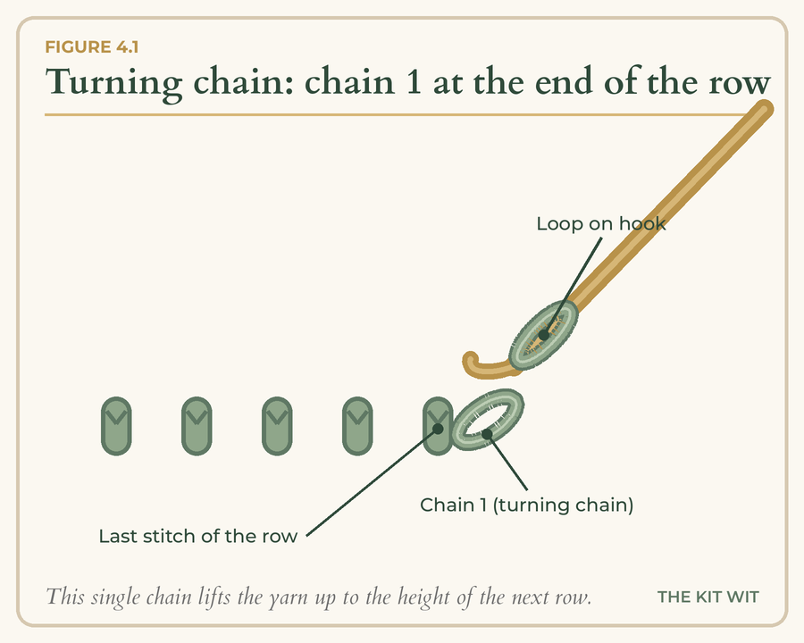
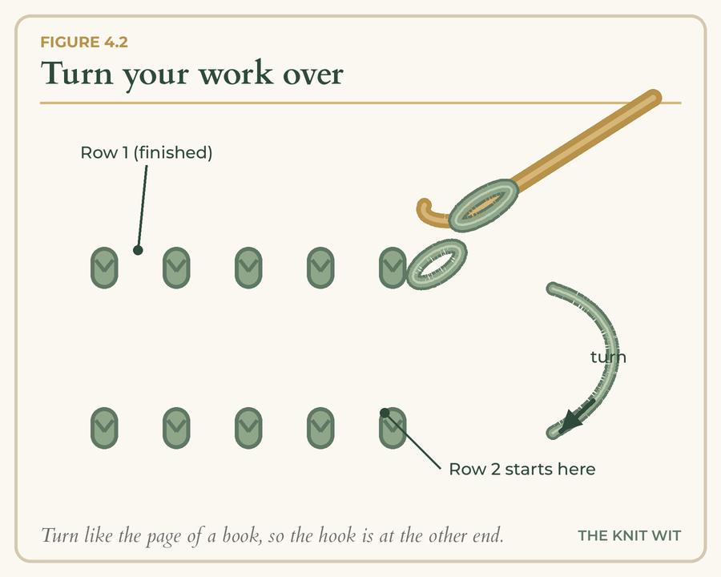
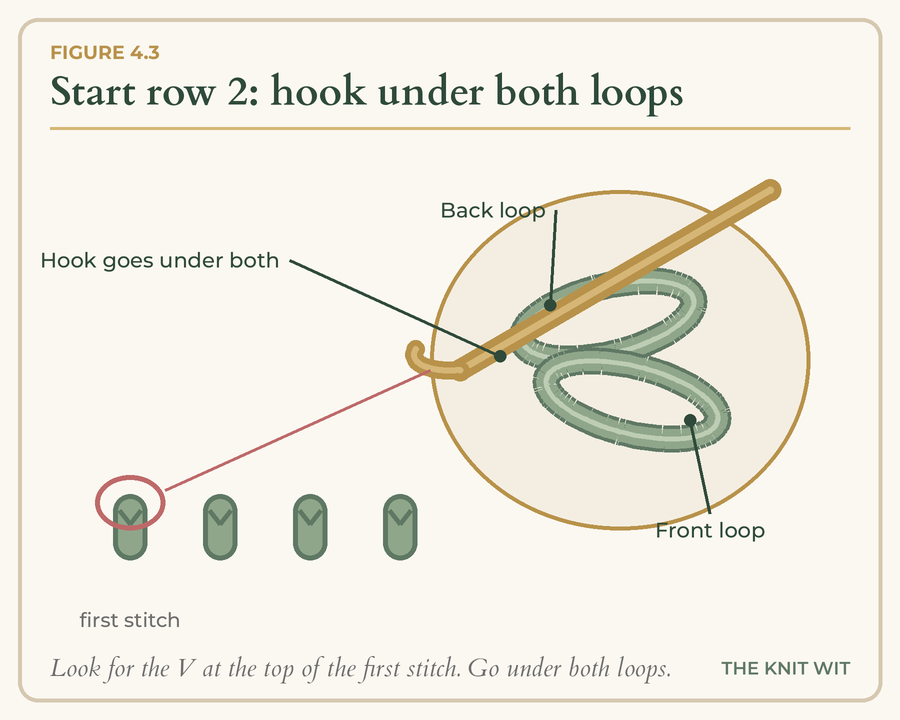

Once you reach the end of a row, you turn your work around and crochet back the other way. This is how a flat piece of fabric grows.

## What you need
- Yarn
- A crochet hook (5mm or 6mm)
- A finished row of single crochet (see our single crochet lesson)

## Steps

**1. Make the turning chain.** At the end of your row, make **1 chain**. This lifts your yarn up to the height of the next row.

**2. Turn your work.** Turn it over like the page of a book, so the hook is at the other end.

**3. Go under both loops.** Look at the top of your first stitch. You will see a "V." Put your hook under **both loops** of the V, then make a single crochet.

**4. Keep going.** Make a single crochet in each stitch across. At the end, chain 1, turn, and repeat for row 3.

## Tips
- Count your stitches at the end of every row. The number should stay the same.
- Don't skip the last stitch. It's the one most beginners miss.
- If your edges look wavy, check that you made only one turning chain.

## What's next?
Now that you can make rows, you are ready for a taller stitch: the double crochet. That's our next lesson!
