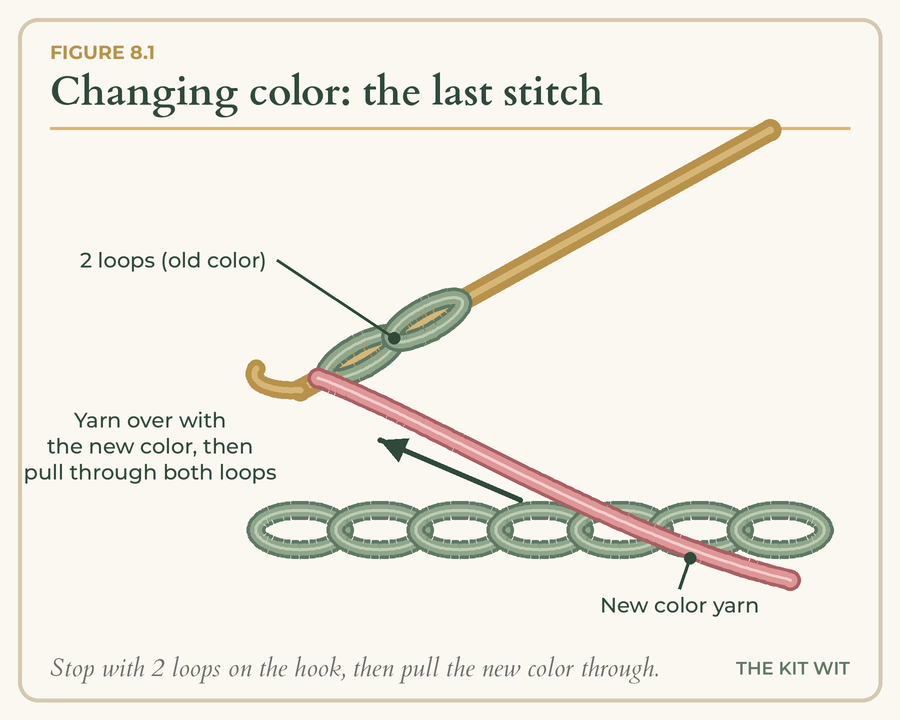
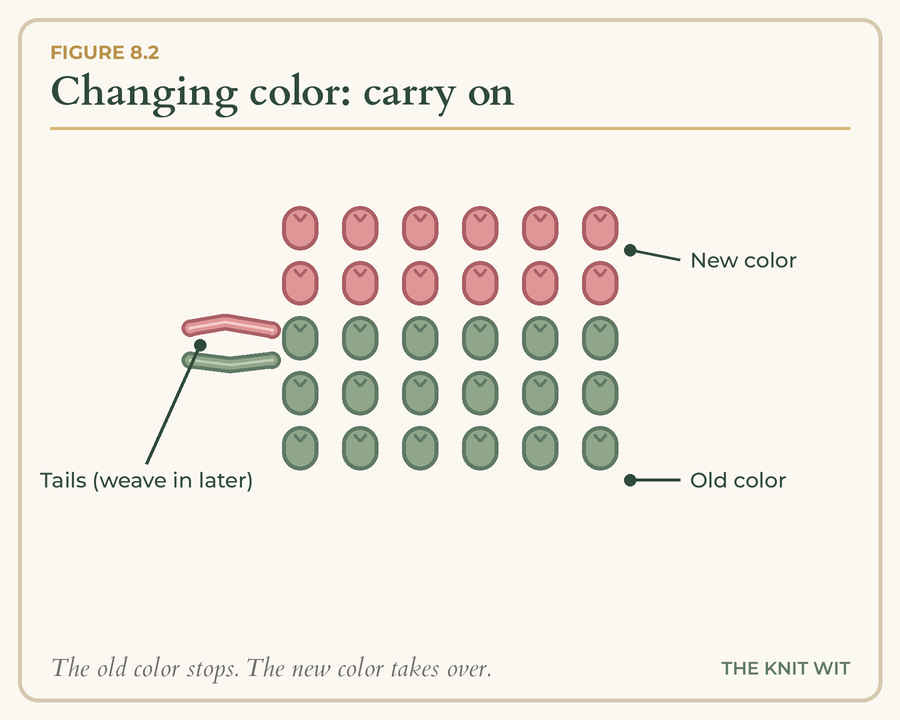
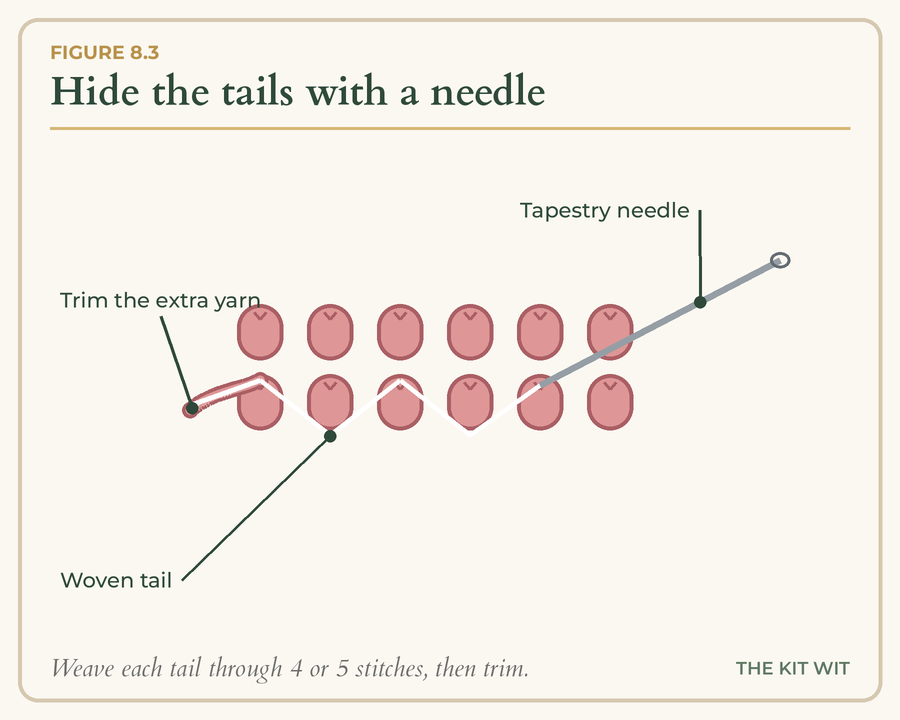

Changing colors is an easy way to make stripes and patterns. The trick is to switch yarn on the last stitch of a row.

## What you need
- Two colors of yarn
- A crochet hook
- Scissors and a tapestry needle

## Steps

**1. Stop with 2 loops.** Work the last stitch of the row until you have 2 loops on your hook. For a single crochet, that's after you pull up the loop and before you pull through.

**2. Pull the new color through.** Yarn over with the new color and pull it through both loops.

**3. Keep going.** Chain 1, turn, and continue the next row with the new color. The old color simply stops. Leave tails of about 4 in (10 cm) on both yarns.

**4. Hide the tails.** Thread each tail onto your tapestry needle and weave it through 4 or 5 stitches on the back. Then trim the extra yarn.

## Tips
- Change colors at the end of a row, so the stripes stay neat.
- Don't pull the new color too tightly, or the edge will pucker.
- Tie nothing. Woven tails hold better than knots and won't show.

## What's next?
Our last beginner lesson shows you how to fix mistakes, because everyone makes them!
