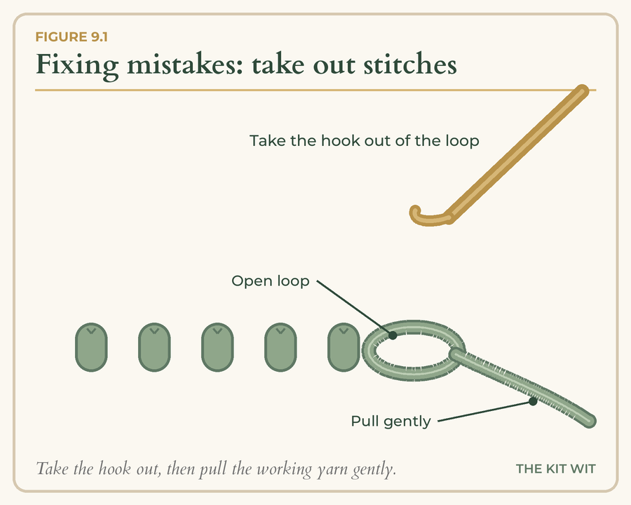
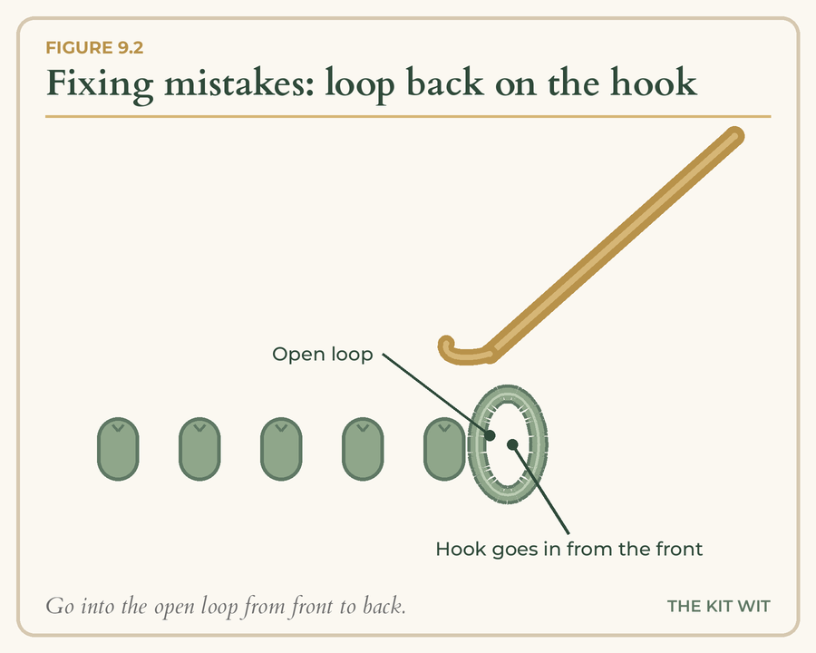
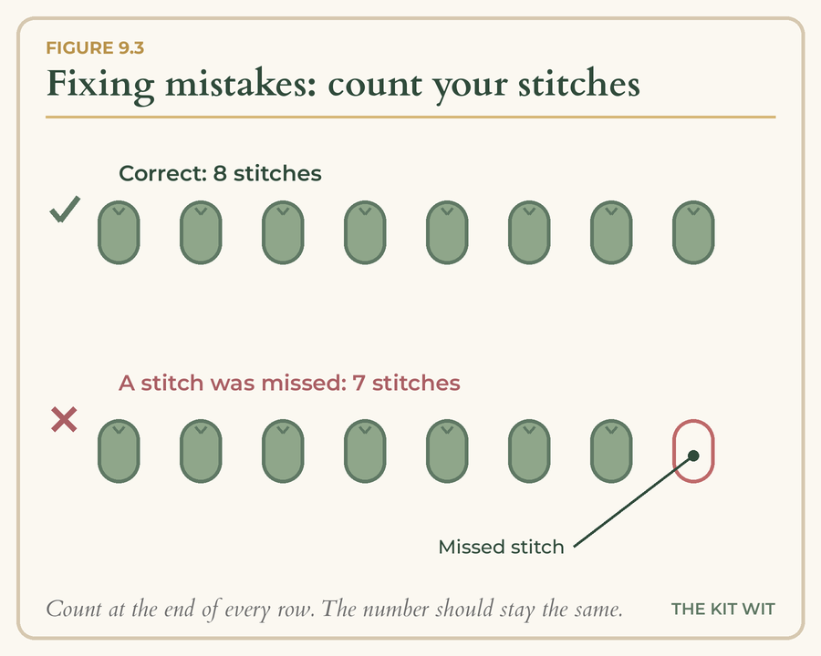

Every crocheter makes mistakes, even experts. The good news is that crochet is easy to undo. Here's how to fix the three most common problems.

## 1. Take out stitches
If you spot a mistake a few stitches back, you can undo your work.

1. Take the hook out of the loop.
2. Gently pull the working yarn. The stitches will come undone one at a time.
3. Stop when you reach the stitch before the mistake.

## 2. Put the loop back on the hook
After pulling out stitches, you'll have an open loop. Put it back on your hook right away so it doesn't unravel.

1. Hold the open loop.
2. Put the hook into the loop from front to back.
3. Check that the loop isn't twisted, then keep crocheting.

## 3. Count your stitches
Most mistakes come from adding or missing a stitch. Count at the end of every row. The number should stay the same.

- **More stitches than before:** you made two stitches in one place. Take out the row and try again.
- **Fewer stitches than before:** you missed one, often the last stitch of the row. Take out the row and find where it went missing.

## Tips
- Use a stitch marker (or a small piece of yarn) on the first stitch of each row, so it's easy to find.
- Fix a mistake as soon as you spot it. It gets harder the further you go.
- Don't be upset about mistakes. They're part of learning.

## What's next?
You've finished the beginner course! Next we'll try bigger projects, like a scarf.
