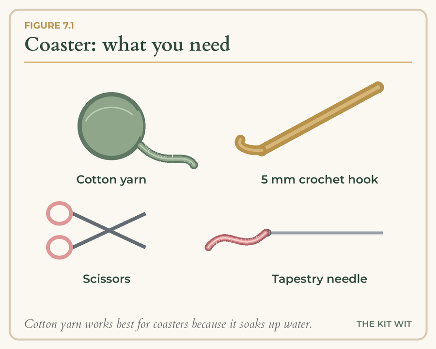
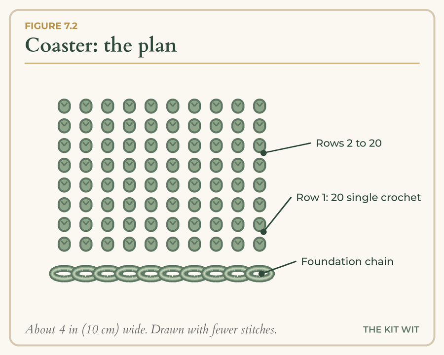
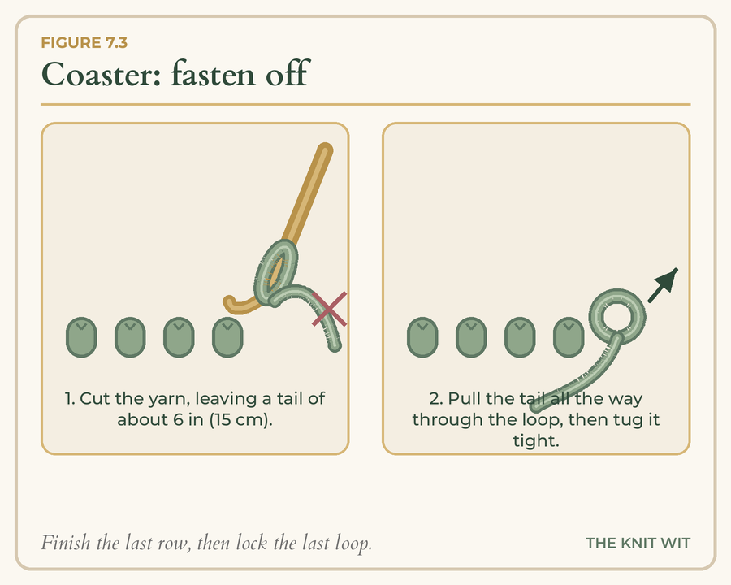

Time for your first real project! A coaster is small, quick, and uses only the stitches you already know: chain and single crochet.

## What you need
- Cotton yarn (about 20 g). Cotton soaks up water, so it works best for coasters.
- A 5 mm crochet hook
- Scissors
- A tapestry needle (a large blunt needle for hiding yarn ends)

## The pattern
This pattern uses the abbreviations from our pattern lesson.

**Row 1:** Ch 21. Sc in 2nd ch from hook and in each ch across. (20)

**Rows 2 to 20:** Ch 1, turn. Sc in each st across. (20)

## Step by step
1. Make a slip knot and chain 21.
2. Row 1: skip the first chain and make a single crochet in the second chain. Make one single crochet in every chain across. You should have 20 stitches.
3. Row 2: chain 1, turn, and make a single crochet in each stitch across.
4. Repeat row 2 until you have 20 rows. The piece should look square.

## Finishing
1. After the last stitch, cut the yarn, leaving a tail of about 6 in (15 cm).
2. Pull the tail all the way through the loop on your hook, then tug it tight. This is called "fastening off."

3. Thread the tail onto your tapestry needle and weave it through the stitches on the back. Do the same with the tail at the start. Then trim the extra yarn.

## Tips
- Count your stitches at the end of every row. It should always be 20.
- If your coaster looks like a rectangle, add or remove a few rows until it's square.
- Your size may differ a little from 4 in (10 cm). That's normal.

## What's next?
Next, we'll learn how to change colors, so you can make striped coasters!
